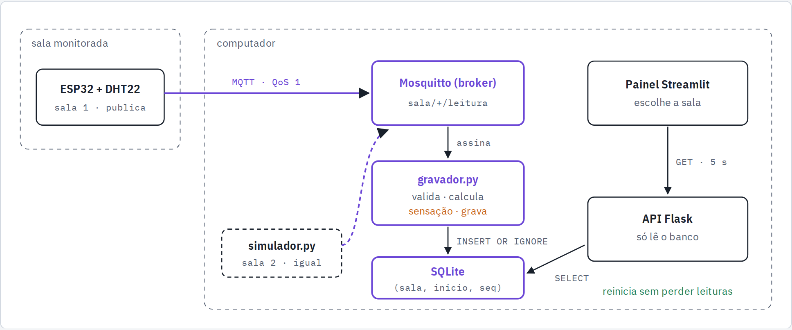
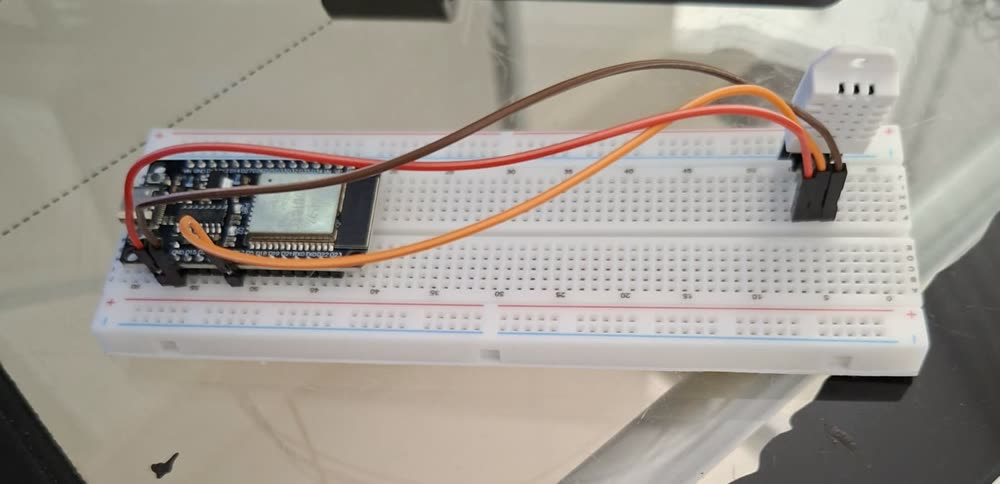
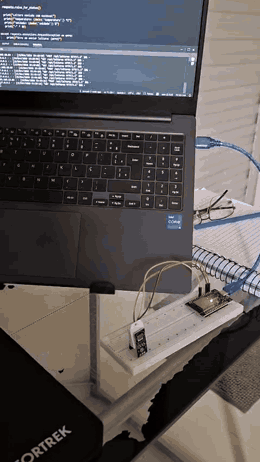
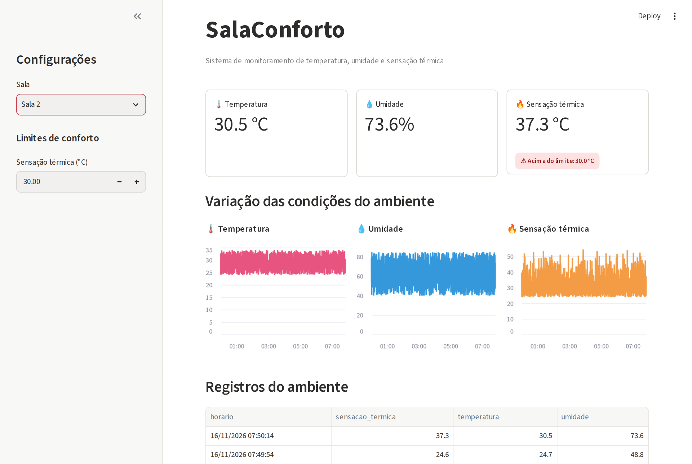

# SalaConforto

Sistema de monitoramento de temperatura, umidade e sensação térmica de ambientes como salas de aula, laboratórios e
escritórios. A sensação térmica combina temperatura e umidade: com 32 °C e 70 % de umidade, ela chega a cerca de 40 °C.

Uma placa ESP32 com um sensor DHT22 publica as leituras por MQTT num broker Mosquitto. Um gravador em Python valida
cada leitura, calcula a sensação térmica e grava num banco SQLite. Uma API Flask consulta o banco, e um painel
Streamlit mostra as leituras de cada sala. Para testes sem a placa, um simulador publica leituras na sala 2.

<picture>
  <source media="(prefers-color-scheme: dark)" srcset="docs/arquitetura-dark.png">
  
</picture>

Detalhes das peças e das dependências: [ARQUITETURA.md](ARQUITETURA.md).

## Montagem e painel

| Montagem | Placa e painel em funcionamento |
|---|---|
|  |  |
| ESP32 e DHT22 numa protoboard. | Leituras da placa chegando ao painel. |

<picture>
  <source media="(prefers-color-scheme: dark)" srcset="docs/painel-dark.png">
  
</picture>

Painel com as leituras da sala 2 e o limite de conforto.

## Rodar

```bash
git clone https://github.com/edytarcio/salaconforto-iot.git
cd salaconforto-iot
python3 -m venv venv && source venv/bin/activate     # Windows: python -m venv venv e .\venv\Scripts\Activate.ps1
pip install -r requirements.txt
```

Instale o Mosquitto (Linux: `sudo apt install mosquitto` e `sudo systemctl stop mosquitto`; Windows: mosquitto.org,
e `net stop mosquitto`). Depois, um terminal por linha, com o venv ativado:

```bash
mosquitto -c broker/mosquitto.conf -v
python backend/gravador.py
python backend/app.py
python dispositivo_simulador/simulador.py
streamlit run frontend/dashboard.py
```

Abra http://localhost:8501 e escolha a sala 2. Para conferir tudo: `python verificar.py --ponta-a-ponta` (sem placa
real, os avisos de `credenciais.h` e da sala 1 são normais).

## Rede e placa real

O computador e a placa precisam estar no mesmo Wi-Fi (2,4 GHz). Para validar e testar, use o roteador do celular:
redes de visitantes ou com login exigem configuração adicional.

<details>
<summary>Rede: firewall e troca de rede</summary>

- Libere as portas 1883 (broker) e 8501 (painel) no computador.
  - Linux, se o ufw estiver ativo: `sudo ufw allow 1883,8501/tcp`
  - Windows (PowerShell de administrador):
    `New-NetFirewallRule -DisplayName SalaConforto -Direction Inbound -Protocol TCP -LocalPort 1883,8501 -Action Allow`
- Outros aparelhos abrem o painel em `http://<IP do computador>:8501`; o `verificar.py` mostra o IP.
- Ao trocar de rede, o IP do computador muda: atualize o `MQTT_HOST` da placa e grave de novo.
- O broker aceita conexões da rede sem senha: serve para demonstração, não para uma rede aberta.

</details>

<details>
<summary>Placa real: ligação, credenciais e gravação</summary>

1. DHT22: 3,3 V, GND e dados no **GPIO 17** (o sensor avulso precisa de um resistor de 10 kΩ entre dados e 3,3 V).
2. Copie `firmware/credenciais.exemplo.h` para `firmware/credenciais.h` (fica fora do git) e preencha o Wi-Fi, o IP do
   computador (`MQTT_HOST`) e a sala (`SALA_ID`, um número diferente por placa; a 2 é do simulador).
3. Grave pela Arduino IDE ou pelo arduino-cli (no Windows, a porta é `COM3`, `COM4`…; veja `arduino-cli board list`):

```bash
arduino-cli config add board_manager.additional_urls https://espressif.github.io/arduino-esp32/package_esp32_index.json
arduino-cli core update-index && arduino-cli core install esp32:esp32
arduino-cli lib install "DHT sensor library" "Adafruit Unified Sensor" "MQTT"
arduino-cli compile --fqbn esp32:esp32:esp32 firmware
arduino-cli upload -p /dev/ttyUSB0 --fqbn esp32:esp32:esp32 firmware
```

No monitor serial (115200), a placa mostra a conexão ao Wi-Fi, ao broker e cada leitura publicada.

</details>
